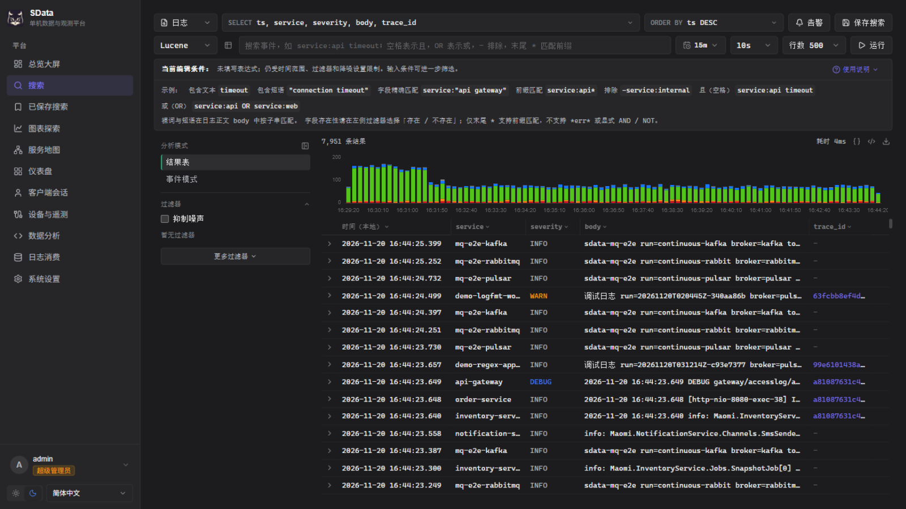
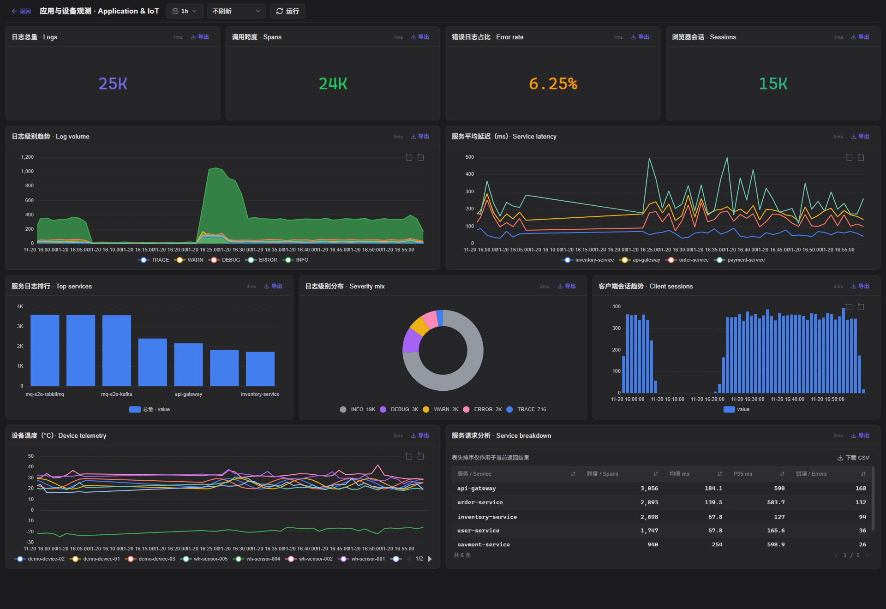

# SData

[简体中文](README.md) | **English**

**One app for logs, traces, metrics, and device data.**

SData is a lightweight data and observability platform powered by DuckDB. Built for single-machine use on private networks, it brings backend troubleshooting, browser experience, and device telemetry into one workspace.

📖 **[Documentation & tutorials (Chinese)](https://docs.whuanle.cn/zh/sdata)**

## Capabilities

| Capability | Features |
| --- | --- |
| Log search | Lucene / SQL conditions, nested JSON filters, field and value suggestions, log distribution, live tail, and surrounding context |
| Trace analysis | Trace waterfalls, Span durations and events, related logs, and nearby traces to investigate slow requests and failures |
| Service maps | Service dependencies, call direction, request volume, latency, errors, and drill-down into real traces |
| Metrics | Metric and label filters, aggregations, grouping, and multi-series charts; a PromQL subset and Prometheus-compatible query endpoints |
| Chart exploration | Visual query builder / SQL modes with time series, numbers, bars, donuts, tables, heatmaps, and event search |
| Flexible dashboards | Drag-and-drop layouts, multiple queries and formulas, shared time ranges, auto-refresh, presentation mode, and import/export |
| Browser experience | Performance metrics, JavaScript errors, session timelines and replay, with supporting click heatmaps and page navigation views |
| Device telemetry | Device inventory, MQTT / HTTP ingestion, latest readings, historical charts, and comparisons across devices |
| Data ingestion | OTLP HTTP / gRPC, ES Bulk, JSON, MQTT, browser SDKs, and log consumption from Kafka / RabbitMQ / Pulsar |
| Log consumption management | Multiple instances and topic rules, JSON / regex / CSV / Logfmt / Syslog parsers, sample parsing, status, and historical statistics |
| Saved searches & alerts | Save searches, share query links, export CSV, and trigger notifications based on search counts |
| Team workflows | Read-only / read-write access, ingestion credentials, notification channels, retention policies, and historical data archives |

## Feature walkthroughs

### Follow an error log through its trace

- Enter `service:api-gateway severity:ERROR` to narrow down failures, or search by keywords and nested JSON attributes.
- Click the log distribution chart to zoom into a time window, then inspect the full record and surrounding logs.
- Follow `trace_id` into the waterfall to inspect Span durations, events, and related logs.
- Save frequently used conditions or share the query URL with the team.

### Investigate slow requests through service dependencies

Select a service and time range in the service map to inspect upstream and downstream calls, latency, and errors. Drill into a trace to identify whether time is spent at the gateway, in business services, or in downstream calls—without searching each service separately.

### Observe applications and devices on one dashboard

- Track log and Span totals, error-log rate, and browser session counts at the top.
- Compare log volume with service latency using area and multi-series line charts; use bars and donuts for service rankings and severity distribution.
- Bring session trends, device temperatures, and service details together under a shared time range.
- Arrange panels freely, calculate formulas across queries (such as errors ÷ total), and use auto-refresh or presentation mode.

*The screenshot shows sample data, not load-test results.*

### Revisit a browser issue

Filter client sessions by project, time, and search conditions. Open the event timeline and combine JavaScript errors, performance events, and captured session replay to reconstruct what happened in the browser.

### Explore device readings over time

Inspect the latest telemetry in the device inventory, select a signal to chart its history, and compare devices in Chart Explorer to investigate temperature spikes, unusual readings, and trends.

## Measured single-machine performance

The existing local storage-layer sample reports the following results. **These are not HTTP throughput figures or maximum machine capacity.**

| Test workload | Batch write speed | Search P95 |
| --- | --- | --- |
| Search + writes | 32,509 records/s | 2.48 ms |
| Search + writes + serial alert evaluation | 31,464 records/s | 2.62 ms |

Historical local test: Windows x64 / .NET 10.0.11 / 2 DuckDB query threads; 100,000 initial logs, 30 searches and 3,000 inserted records per sample, in batches of 100. Write speed measures batch-writer time only, excluding HTTP and queueing; hardware details were not fully recorded. [Results & methodology](assets/readme/performance-sample.md) · [Test source](tests/SData.Store.Tests/AlertPerformanceTests.cs).

**Single-machine HTTP concurrency and sustained end-to-end ingestion throughput have not been fully benchmarked; no capacity claim is made.**
