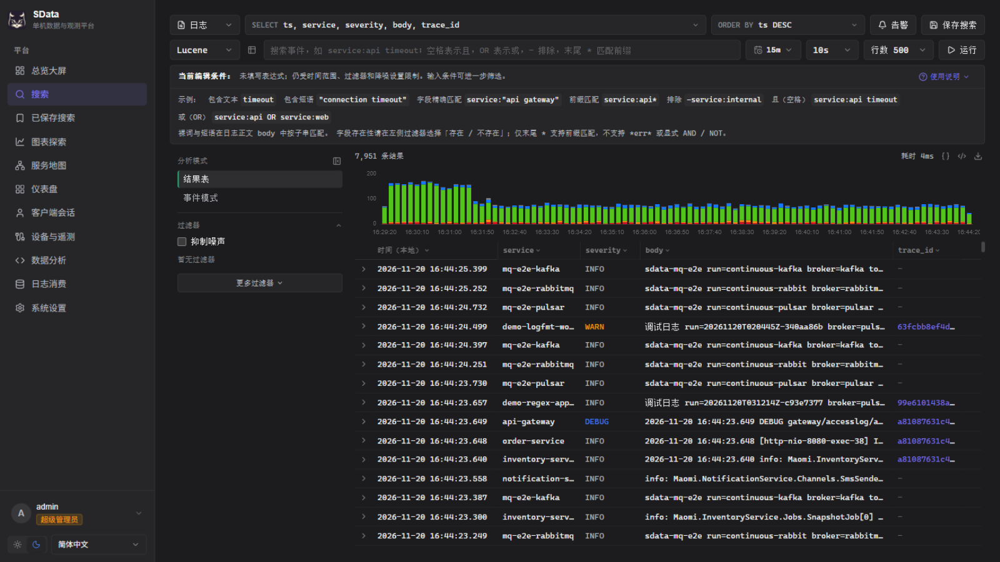
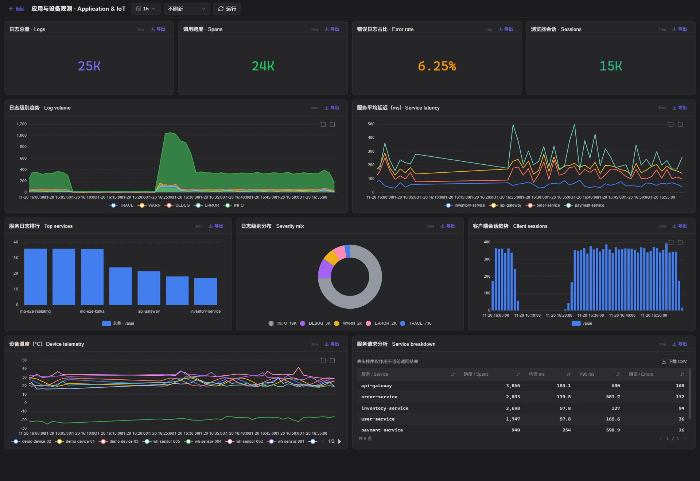

# SData

**简体中文** | [English](README.en.md)

**一个应用，看日志、查链路、分析指标与设备数据。**

SData 是基于 DuckDB 引擎的轻量级数据与观测平台，面向内网单机场景，把服务端排障、浏览器体验和设备遥测放在同一个工作台。

📖 **[文档与使用教程](https://docs.whuanle.cn/zh/sdata)**

## 能做什么

| 能力 | 功能 |
| --- | --- |
| 日志搜索 | Lucene / SQL 条件、嵌套 JSON 属性筛选、字段和值建议、日志分布、实时追踪、上下文查看 |
| 调用链分析 | Trace 瀑布图、Span 耗时与事件、关联日志、周边链路查询，定位慢请求和异常环节 |
| 服务地图 | 查看服务依赖、调用方向、请求量、延迟与错误情况，从依赖关系钻取真实 Trace |
| 指标分析 | 指标与标签筛选、聚合与分组、多序列曲线，支持 PromQL 子集及 Prometheus 兼容查询接口 |
| 图表探索 | 可视化查询 / SQL 双模式，支持时序、数值、柱状、环形、表格、热力图和事件搜索 |
| 自由仪表盘 | 拖拽布局、多查询与公式计算、统一时间范围、自动刷新、大屏展示、导入导出 |
| 浏览器体验 | 性能指标、JavaScript 错误、会话事件时间线与回放，辅助查看点击热力与页面访问路径 |
| 设备遥测 | 设备台账、MQTT / HTTP 数据接入、最新读数、历史曲线，在图表中对比多个设备 |
| 数据接入 | OTLP HTTP / gRPC、ES Bulk、JSON、MQTT、浏览器 SDK，以及 Kafka / RabbitMQ / Pulsar 日志消费 |
| 日志消费管理 | 多实例与主题规则、JSON / 正则 / CSV / Logfmt / Syslog 等解析方式、样例试解析、消费状态与历史统计 |
| 搜索与告警 | 保存搜索、分享查询链接、导出 CSV，按搜索次数配置告警并发送到通知渠道 |
| 团队协作 | 只读 / 读写权限、接入凭据管理、通知渠道、数据保留与历史数据归档 |

## 功能演示

### 从一条错误日志追到整条调用链

- 输入 `service:api-gateway severity:ERROR`，按服务与级别定位异常；也可以直接搜索关键词或嵌套 JSON 属性。
- 点击日志分布图缩小时间范围，打开记录查看完整字段与前后日志。
- 沿 `trace_id` 跳转调用链，在瀑布图里查看各个 Span 的耗时、事件与关联日志。
- 将常用条件保存为搜索，或复制查询链接与团队共享。

### 从服务依赖定位慢请求

在服务地图中选择服务与时间范围，查看上下游调用关系、延迟和错误分布；钻取具体 Trace，判断耗时集中在入口、业务服务还是下游调用，不用逐个服务翻日志。

### 一张看板同时观察应用与设备

- 顶部查看日志总量、调用跨度、错误日志占比与浏览器会话数。
- 面积图和多序列折线图对照日志变化与服务延迟；柱状图、环形图展示服务排行与级别分布。
- 将会话趋势、设备温度与服务明细放进同一看板，统一时间范围查看变化。
- 支持拖拽布局、多查询公式（如错误数 ÷ 总量）、自动刷新与大屏展示。

*截图为示例数据看板，不是性能压测结果。*

### 回看浏览器里的问题

按项目、时间和会话条件筛选客户端会话，打开事件时间线，结合 JavaScript 错误、性能事件和已采集的会话回放，复现页面操作过程。

### 查看设备状态与历史变化

在设备台账中查看最新遥测值，选择信号绘制历史曲线；通过图表探索对比多台设备，发现温度突变、读数异常与变化趋势。

## 单机性能实测

现有本地存储层短测记录如下，**不代表 HTTP 接口吞吐或整机性能上限**：

| 测试负载 | 批量写入速度 | 搜索 P95 |
| --- | --- | --- |
| 搜索 + 写入 | 32,509 条/秒 | 2.48 ms |
| 搜索 + 写入 + 串行告警评估 | 31,464 条/秒 | 2.62 ms |

历史本地测试：Windows x64 / .NET 10.0.11 / DuckDB 2 线程；10 万条初始日志，每组 30 次搜索、写入 3,000 条，每批 100 条。写入速度仅计批量写入器耗时，不含 HTTP 与排队；硬件信息未完整记录。[测试记录与口径](assets/readme/performance-sample.md) · [测试代码](tests/SData.Store.Tests/AlertPerformanceTests.cs)。

**单机 HTTP 并发量、端到端持续写入速度：尚无完整压测结论，暂不标称。**
